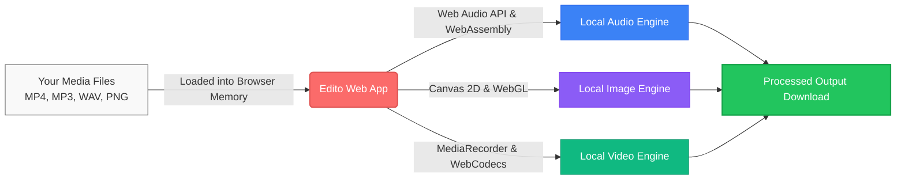

# 🎨 Edito (Edit Studio)

> **100% Client-Side Private Audio, Video & Creative Web Studio**  
> Edit, convert, trim, separate stems, and remove watermarks directly in your browser — your files never leave your device.

[](https://nextjs.org/)
[](https://react.dev/)
[](https://www.typescriptlang.org/)
[](https://tailwindcss.com/)
[](#-privacy-architecture)
[](LICENSE)

---

## 🌟 Overview

**Edito** is an all-in-one web creative suite built for speed, simplicity, and uncompromising privacy. Traditional web media tools force users to upload gigabytes of personal video, audio, and photos to remote cloud servers, incurring privacy risks, bandwidth costs, and queue delays. 

Edito handles audio processing, neural AI separation, canvas manipulation, and video inpainting **100% locally** using cutting-edge Web APIs (**Web Audio API**, **WebAssembly**, **WebGPU**, **Canvas 2D**, and **MediaStream/WebCodecs**).

---

## ⚡ Core Features & Tools

### 🎵 1. Audio Hub & AI Stem Separation
- **AI Stem Separator (`/stems`):** Isolate vocals, accompaniment, drums, and bass with interactive multi-track playback, pitch & tempo control, and individual stem exports.
- **AI Vocal Remover (`/audio/vocal-remover`):** One-click extraction of clean acapellas or karaoke instrumental tracks with local neural processing.
- **Audio Cutter & Trimmer (`/audio/cutter`):** Interactive waveform scrubbing, millisecond-accurate start/end trimming, and customizable fade-in/fade-out curves.
- **Audio Converter (`/audio/converter`):** Transcode between MP3, WAV, AAC, M4A, FLAC, and OGG with custom bitrates and sample rates.
- **Video to Audio (`/audio/video-to-audio`):** Extract crystal-clear audio from MP4, WebM, MOV, and MKV video files.
- **Audio Merger & Joiner (`/audio/merger`):** Combine multiple audio clips with seamless crossfades.
- **Split Audio (`/audio/split`):** Segment audio tracks by silence threshold detection or fixed duration intervals with instant ZIP packaging.
- **Multi-Track Audio Mixer (`/audio/mix`):** Layer tracks with independent volume faders, panning, and time offsets.
- **Audio Speed & Tempo (`/audio/speed`):** Shift playback rate from 0.5x to 2.0x without pitch distortion.
- **Volume Booster & Normalizer (`/audio/volume`):** Amplify quiet recordings up to +20dB with peak normalization.
- **Blank Audio Generator (`/audio/blank`):** Generate calibrated silence files of exact millisecond durations.

---

### 🎬 2. Video Studio
- **AI Video Watermark Remover (`/creative/remove-video-watermark`):**
  - **Direct Cursor Interaction:** Click & drag anywhere on video frames to draw, move, and corner-resize watermark boxes.
  - **Photoshop-Grade Clean Background (0% Blur):** Smart auto-direction texture cloning that heals background color and lighting without blurry smudges.
  - **Quick Corner Snaps:** 1-click presets for TikTok, Reels, CapCut, timestamps, and logos.
  - **Full Video Seekable Export:** Integrated `fix-webm-duration` patches EBML headers for perfect scrubbing and timer playback in Windows Media Player and native video players.
- **Video Trimmer & Speed Editor (`/creative/video-editor`):**
  - Trim unwanted frames with dual range slider controls.
  - Variable speed playback (0.25x to 4x).
  - Audio mute & track extraction.

---

### 🎨 3. Creative Image Suite
- **AI Photo Watermark Remover (`/creative/remove-watermark`):** Delogo inpainting with interactive brush controls and before/after slider comparison.
- **AI Background Remover (`/creative/remove-background`):** Single-click subject cutout, transparent PNG exports, and solid studio color backdrops.
- **Canvas Photo Editor (`/creative/photo-editor`):** Crop, rotate, adjust brightness/contrast/saturation, add text overlays, and draw freehand.
- **Bulk Image Resizer (`/creative/resize-image`):** Lanczos high-quality downscaling, target file weight limits (e.g. 50 KB), social media aspect ratios, and batch ZIP export.
- **Photo Collage Maker (`/creative/make-collage`):** Flexible grid arrangements with border radius and custom spacing.
- **WebGL Photo Effects (`/creative/apply-effects`):** Real-time shaders including Cyberpunk, Cinematic LUTs, Glitch, Vignette, and Grain.
- **Face & Skin Retouch (`/creative/retouch`):** Natural skin smoothing, blemish reduction, and eye/teeth brightening.

---

## 🔒 Privacy Architecture



- **Zero Server Uploads:** Media files never leave your device. All decoding, processing, and encoding happen strictly within your browser's runtime sandbox.
- **Bandwidth Friendly:** Works offline or on slow internet connections after the initial page load.
- **Compliance:** Built-in GDPR, CCPA, and enterprise privacy compliance by architecture.

---

## 🛠️ Tech Stack

| Category | Technology |
|---|---|
| **Framework** | [Next.js 16](https://nextjs.org/) (Turbopack, App Router) |
| **Language** | [TypeScript 5](https://www.typescriptlang.org/) |
| **UI Library** | [React 19](https://react.dev/), [Radix UI](https://www.radix-ui.com/), [Lucide Icons](https://lucide.dev/) |
| **Styling** | [Tailwind CSS v4](https://tailwindcss.com/) |
| **Audio Processing** | Web Audio API, `@breezystack/lamejs` |
| **Video Processing** | HTML5 Canvas, MediaStream, `MediaRecorder`, `fix-webm-duration` |
| **Packaging & Compression** | `fflate` (ZIP generation in memory) |
| **Storage & Caching** | IndexedDB via `idb` |

---

## 🚀 Getting Started

### Prerequisites
- **Node.js** 18.18.0 or later
- **npm**, **pnpm**, or **yarn**

### Installation

1. **Clone the repository:**
   ```bash
   git clone https://github.com/your-username/edit_studio.git
   cd edit_studio
   ```

2. **Install dependencies:**
   ```bash
   npm install
   ```

3. **Start the local development server:**
   ```bash
   npm run dev
   ```

4. **Open in browser:**
   Navigate to [http://localhost:3000](http://localhost:3000).

---

## 📁 Project Directory Structure

```text
edit_studio/
├── public/                 # Static assets, icons, and SVG illustrations
├── src/
│   ├── app/                # Next.js App Router (57+ routes)
│   │   ├── (app)/          # Main dashboard & home landing
│   │   ├── audio/          # Audio Hub tool routes (cutter, converter, etc.)
│   │   ├── creative/       # Creative Studio tool routes (video, watermark, etc.)
│   │   ├── stems/          # Stem Separation Studio
│   │   └── admin/          # Admin telemetry and local log dashboard
│   ├── components/         # Shared UI components and modals
│   ├── config/             # Tools catalog, navigation definitions, and SEO data
│   ├── design-system/      # Atomic UI primitives, buttons, sliders, cards
│   ├── features/           # Feature-specific modules (stems, audio toolbox)
│   └── lib/                # Core processing engines
│       ├── audio/          # Web Audio DSP, encoding, and conversion
│       ├── image/          # Canvas inpainting, filters, and resizing
│       ├── video/          # Real-time frame delogo inpainting & texture healing
│       └── utils.ts        # Formatting and helper utilities
├── package.json            # Dependencies and scripts
├── tsconfig.json           # TypeScript configuration
└── README.md               # Project documentation
```

---

## 📜 Available Scripts

- `npm run dev` - Starts the development server with Turbopack.
- `npm run build` - Generates an optimized production build.
- `npm run start` - Serves the production build.
- `npm run lint` - Runs ESLint code style and quality checks.

---

## 📄 License

This project is licensed under the [MIT License](LICENSE).
